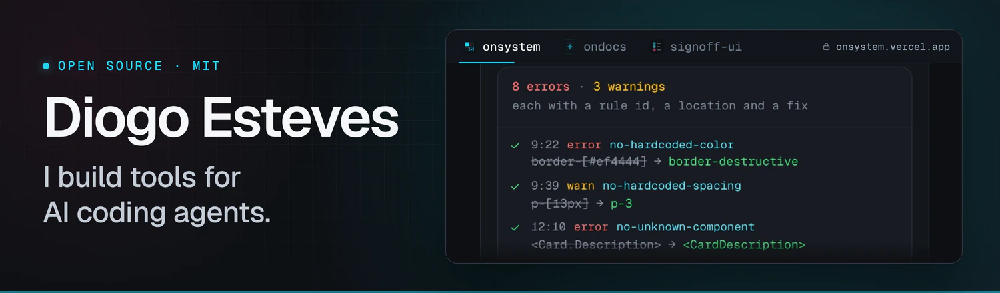
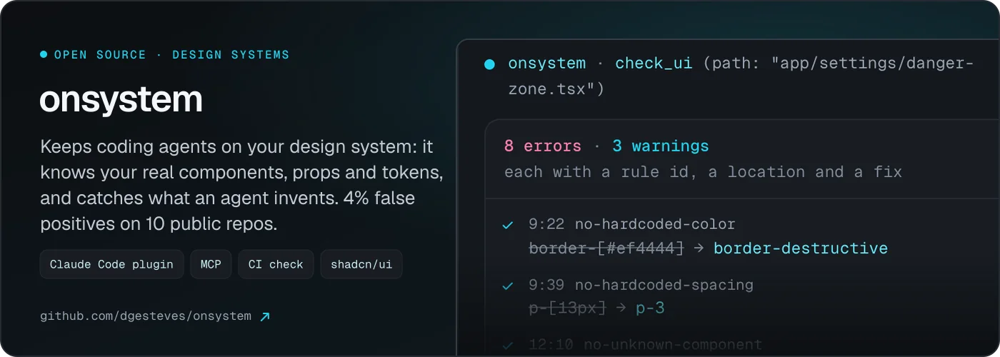
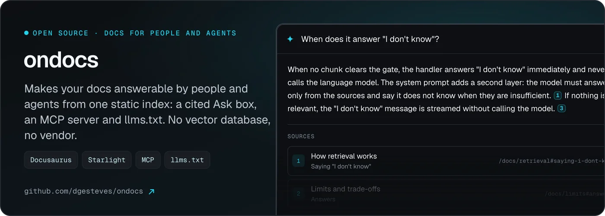
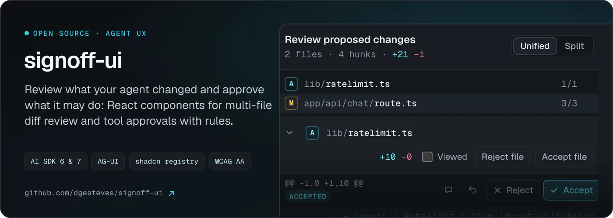
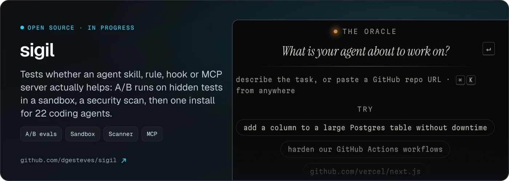
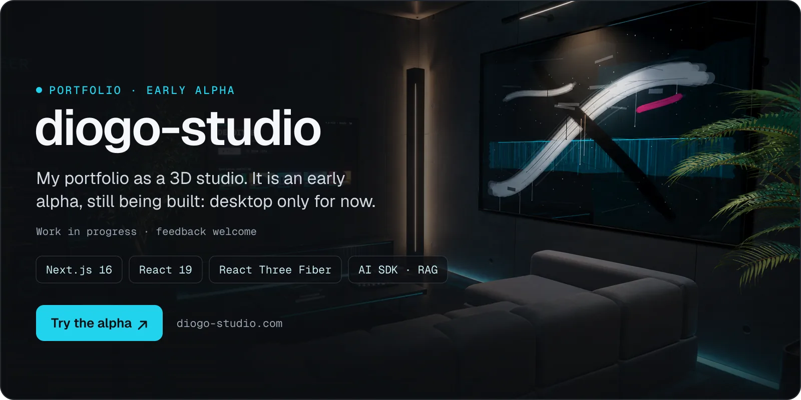
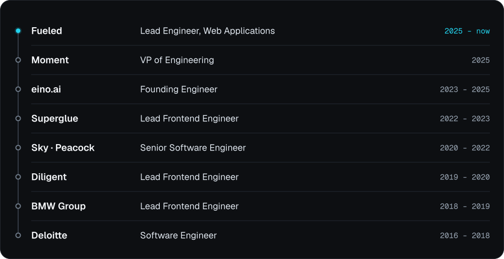

  

  &nbsp;
  &nbsp;
  

I'm a full-stack engineer in Lisbon with 10+ years of experience, mostly with TypeScript, React and Node.js. Since 2023 I've worked on AI products: first hire after the founders at eino.ai, then VP of Engineering at Moment. Today I'm a Lead Engineer at [Fueled](https://fueled.com). In my own time I build open-source tools for teams that use coding agents.

### Open source

<picture>
  <source media="(prefers-reduced-motion: reduce)" srcset="assets/banner-still.png">
  
</picture>

https://github.com/user-attachments/assets/232e46a3-92e9-4a3a-9814-1120334e35d8

Websites, each with docs and a live demo: [onsystem](https://onsystem.vercel.app) · [ondocs](https://ondocs.vercel.app) · [signoff-ui](https://signoff-ui.vercel.app) · [sigil](https://sigil-lab.vercel.app) (early, not on npm yet)

### Portfolio

### Experience

More detail on [LinkedIn](https://www.linkedin.com/in/diogo-esteves/).

### Stack

### Activity

<picture>
  <source media="(prefers-color-scheme: dark)" srcset="https://raw.githubusercontent.com/dgesteves/dgesteves/output/snake-dark.svg">
  <source media="(prefers-color-scheme: light)" srcset="https://raw.githubusercontent.com/dgesteves/dgesteves/output/snake-light.svg">
  
</picture>

### Elsewhere

I started WebDevPortugal, a community for web engineers in Portugal, and I'm a member of GDG Lisbon.

---

Open to full-stack and AI engineering roles. Email: [diogo.esteves.goncalves@gmail.com](mailto:diogo.esteves.goncalves@gmail.com)
